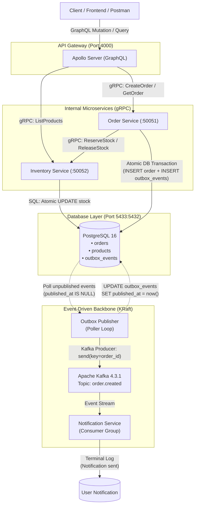

# ORDERFLOW

A clean, event-driven e-commerce order processing microservices system built with **TypeScript (strict)**, **GraphQL (Apollo Server)**, **gRPC & Protocol Buffers**, **Apache Kafka (KRaft mode)**, **PostgreSQL**, **Docker Compose**, and the **Transactional Outbox Pattern**.

Designed specifically for clarity, interview teachability, and robust system design fundamentals without unnecessary architectural bloat.

---

## 1. System Architecture



### Why Each Technology Was Chosen

| Technology | Role | Why It Was Chosen |
|---|---|---|
| **GraphQL (Apollo Server)** | Public API Gateway | Provides a single flexible endpoint for clients. Clients request exactly the fields they need (preventing over-fetching and under-fetching) and can aggregate data from multiple downstream services in a single round-trip. |
| **gRPC** | Synchronous Inter-Service Communication | High performance, multiplexed HTTP/2 transport with binary serialization. Ensures low-latency synchronous calls between internal microservices. |
| **Protocol Buffers (Protobuf)** | Service Interface & Serialization | Strict schema contract shared across microservices. Binary serialization is smaller and faster to parse than JSON, with explicit backwards- and forwards-compatibility rules. |
| **Apache Kafka (KRaft)** | Asynchronous Event Streaming | High-throughput distributed append-only log with durable persistence, partition-level ordering guarantees, and consumer groups for horizontal scalability and independent replayability. Runs in KRaft mode (no Zookeeper required). |
| **Transactional Outbox Pattern** | Reliability & Dual-Write Prevention | Solves the classic "dual-write" failure where a database write succeeds but publishing to the message broker fails (or vice versa). By saving the outbox event in the same atomic SQL transaction as the business entity, message persistence is guaranteed. |
| **PostgreSQL** | Relational Database | ACID transactions guarantee atomicity when persisting orders and outbox records together. Plain SQL via the `pg` client eliminates ORM magic and keeps SQL queries transparent and explicit. |
| **Docker Compose** | Container Orchestration | Single multi-container development environment ensuring identical network isolation, startup ordering (`depends_on` healthchecks), and reproducible runtime behavior. |

### Kafka Dual Listeners Explained

Kafka runs inside a Docker network but must often be reachable from both containerized services and the host machine (e.g. local tooling or debugging scripts). Kafka requires distinct advertised listeners for each access context:
- **`PLAINTEXT://kafka:9092` (Internal Listener)**: Advertised to other containers inside the Docker network `orderflow-network`. Services resolve `kafka:9092`.
- **`EXTERNAL://localhost:9094` (Host/External Listener)**: Advertised to processes running directly on the host machine. The host accesses Kafka via `localhost:9094`.

---

## 2. Port Allocation Table

| Service / Component | Container Port | Host Port | Protocol / Purpose |
|---|---|---|---|
| **API Gateway** | `4000` | `4000` | HTTP / GraphQL API (Apollo Studio Sandbox) |
| **Order Service** | `50051` | `50051` | gRPC / Protocol Buffers |
| **Inventory Service** | `50052` | `50052` | gRPC / Protocol Buffers |
| **PostgreSQL** | `5432` | `5433` | PostgreSQL (remapped to `5433` to prevent local conflicts) |
| **Apache Kafka (KRaft)** | `9092` / `9094` | `9094` | Apache Kafka binary protocol |
| **Notification Service** | — | — | Background Kafka consumer worker |

---

## 3. Getting Started

### Prerequisites
- [Docker Desktop](https://www.docker.com/products/docker-desktop/) (running with WSL2 backend on Windows or native Docker on macOS/Linux).
- Node.js 20+ (optional, only needed if running local tests outside Docker).

### Running with Docker Compose

Start the entire system with one command:
```bash
docker compose up --build -d
```

Check the health and status of all services:
```bash
docker compose ps
```

To view logs across all microservices:
```bash
docker compose logs -f
```

To stop all services and preserve data volumes:
```bash
docker compose down
```

---

## 4. End-to-End Verification & Testing

### 1. Place an Order (GraphQL Mutation)

Submit an order via HTTP POST or Apollo Studio (`http://localhost:4000`):

```bash
curl -X POST http://localhost:4000 \
  -H "Content-Type: application/json" \
  -d '{"query": "mutation { placeOrder(productId: 2, quantity: 2, customerName: \"Niranjan\") { id status price } }"}'
```

**Expected Response**:
```json
{
  "data": {
    "placeOrder": {
      "id": "1",
      "status": "CONFIRMED",
      "price": 1000
    }
  }
}
```

### 2. Verify Synchronous and Asynchronous Logs

Observe the coordinated trace across all containers:
1. **Gateway**:
   ```
   [Gateway] Mutation.placeOrder received: customer="Niranjan", productId=2, qty=2
   [Gateway] Mutation.placeOrder succeeded: orderId=1
   ```
2. **Order Service**:
   ```
   [OrderService] CreateOrder received: customer="Niranjan", product_id=2, quantity=2
   [OrderService] Calling inventory-service.ReserveStock(product_id=2, quantity=2)
   [OrderService] Stock reserved at price=1000. Starting DB transaction...
   [OrderService] Transaction COMMITTED: inserted order id=1 and outbox event id=1
   [OutboxPublisher] Published outbox event id=1 (order_id=1) to Kafka topic 'order.created'
   [OutboxPublisher] Marked outbox event id=1 published_at = now()
   ```
3. **Inventory Service**:
   ```
   [InventoryService] ReserveStock received: product_id=2, quantity=2
   [InventoryService] ReserveStock succeeded: reserved 2 units of product 2
   ```
4. **Notification Service**:
   ```
   Notification: Order 1 created for Niranjan
   ```

### 3. Verify Database Persistence

Connect to the PostgreSQL container and inspect tables:

```bash
docker exec -it orderflow-postgres psql -U orderflow -d orderflow
```

```sql
SELECT id, customer_name, product_id, quantity, price, status FROM orders;
SELECT id, event_type, aggregate_id, created_at, published_at FROM outbox_events;
```

`published_at` will contain an exact timestamp, confirming the outbox publisher marked the event as published.

### 4. Query Order via GraphQL

```bash
curl -X POST http://localhost:4000 \
  -H "Content-Type: application/json" \
  -d '{"query": "query { order(id: \"1\") { id customerName status } }"}'
```

### 5. Error Handling Test (Insufficient Stock)

Try purchasing 100 units of product 3 (initial stock is 5):

```bash
curl -X POST http://localhost:4000 \
  -H "Content-Type: application/json" \
  -d '{"query": "mutation { placeOrder(productId: 3, quantity: 100, customerName: \"Test\") { id } }"}'
```

**Expected Response**: GraphQL error with code `BAD_USER_INPUT` (HTTP 400), mapped from gRPC `FAILED_PRECONDITION`. No order is inserted into the database.

### 6. Transactional Outbox Resilience Test (Kafka Downtime)

This test proves that the Transactional Outbox pattern guarantees message delivery even when Kafka crashes:

1. **Stop Kafka**:
   ```bash
   docker compose stop kafka
   ```
2. **Place an order while Kafka is down**:
   ```bash
   curl -X POST http://localhost:4000 \
     -H "Content-Type: application/json" \
     -d '{"query": "mutation { placeOrder(productId: 1, quantity: 1, customerName: \"KafkaTest\") { id status } }"}'
   ```
   *Result*: Order succeeds (`CONFIRMED`). In PostgreSQL, `orders` has the new order and `outbox_events` has the new event with `published_at IS NULL`.
3. **Restart Kafka**:
   ```bash
   docker compose start kafka
   ```
4. **Observe automatic recovery**:
   Within seconds, the background outbox publisher detects Kafka is available, publishes the pending event to `order.created`, sets `published_at = now()`, and `notification-service` logs:
   ```
   Notification: Order 2 created for KafkaTest
   ```

---

## 5. Running Automated Unit Tests

Unit tests are written with **Jest** and test-driven mocks:
1. **Inventory Service**: Validates `ReserveStock` fails with gRPC `FAILED_PRECONDITION` when stock is insufficient.
2. **Order Service - Atomic Transaction**: Verifies that order creation writes BOTH `orders` and `outbox_events` in the exact same SQL transaction.
3. **Order Service - Outbox Fault Tolerance**: Verifies that if publishing to Kafka throws an error, `published_at` remains `NULL` for retry.

Run tests locally:
```bash
# Inventory service tests
cd inventory-service && npm test

# Order service tests
cd ../order-service && npm test
```

---

## 6. Known Limitations & Production Readiness

This project intentionally balances real-world architecture patterns with clarity and interview explainability. The following production concerns are intentionally omitted:

1. **Distributed Rollback / Saga Pattern**:
   - *Current implementation*: Order Service calls Inventory Service to reserve stock before writing the order. If the Order Service crashes or DB commit fails after stock is reserved, stock remains deducted.
   - *Production solution*: Implement a compensating transaction (`ReleaseStock`) or an orchestration/choreography Saga pattern.
2. **At-Least-Once Delivery & Consumer Idempotency**:
   - *Current implementation*: Outbox poller provides at-least-once delivery (if the publisher crashes between publishing to Kafka and updating `published_at`, the message will be published twice).
   - *Production solution*: Consumers must implement idempotency (e.g. maintaining a processed message table or deduplicating by `order_id`).
3. **Polling vs. Change Data Capture (CDC)**:
   - *Current implementation*: A periodic polling loop (`SELECT ... WHERE published_at IS NULL`).
   - *Production solution*: At high scale, table polling introduces DB overhead. Use Debezium or PostgreSQL logical replication to stream WAL events directly to Kafka.
4. **Single-Node Kafka**:
   - *Current implementation*: Single KRaft broker container with replication factor 1.
   - *Production solution*: Multi-broker Kafka cluster with partition replication factor of 3 and `min.insync.replicas=2`.
5. **Shared Database vs. Database-per-Service**:
   - *Current implementation*: Both services connect to the same PostgreSQL instance for local development simplicity.
   - *Production solution*: Each microservice owns its private database (Inventory DB vs. Order DB) to guarantee independent scalability and prevent coupling at the data tier.

---

## 7. Technical Interview Q&A Cheatsheet

### Q1: What is the Transactional Outbox Pattern and why did you use it?
> **Answer**: In distributed systems, writing to a database and publishing an event to a message broker is a "dual-write" problem. You cannot execute an atomic transaction across PostgreSQL and Kafka without complex distributed transaction protocols like 2PC (Two-Phase Commit), which are slow and fragile. If you write to the DB and your service crashes before publishing to Kafka, your message is lost. If you publish to Kafka first and the DB write fails, your message broker contains phantom data.
>
> With the Transactional Outbox pattern, we write both the business entity (`orders`) and an outbox record (`outbox_events`) inside a single local ACID database transaction. An independent publisher process polls or streams from the outbox table and publishes the events to Kafka. Once acknowledged by Kafka, it marks the event published.

### Q2: Why did you choose gRPC for internal communication instead of REST?
> **Answer**: gRPC uses Protocol Buffers over HTTP/2. It offers:
> 1. Strict typed contracts defined in `.proto` files, preventing API drift between teams.
> 2. Binary payload serialization, which is significantly smaller and faster to parse than JSON text.
> 3. HTTP/2 multiplexing, allowing multiple concurrent requests over a single TCP connection without head-of-line blocking.

### Q3: Why place GraphQL at the API Gateway instead of exposing gRPC or REST?
> **Answer**: Mobile and web clients often have different data needs and bandwidth constraints. Exposing gRPC directly to browsers requires gRPC-Web proxies and complex client bundles. REST often leads to multiple round trips or over-fetching unnecessary fields. GraphQL gives frontend clients the ability to fetch exactly what they need in one round-trip while the backend gateway orchestrates internal gRPC calls.

### Q4: How does Kafka achieve partition-level ordering?
> **Answer**: Kafka guarantees ordering **only within a single partition**. When we publish an event, we set the message key to the `order_id` (or customer ID). Kafka hashes the key to assign the partition (`hash(key) % num_partitions`). This guarantees that all lifecycle events for the same order always land on the same partition in sequential order.

### Q5: How does Kafka in KRaft mode differ from Kafka with ZooKeeper?
> **Answer**: KRaft (Kafka Raft Metadata mode) manages cluster metadata and consensus directly inside Kafka using an event-driven Raft protocol, eliminating the dependency on Apache ZooKeeper. This reduces operational complexity, accelerates metadata propagation, speeds up controller failover times, and simplifies containerized deployments.
# orderflow

